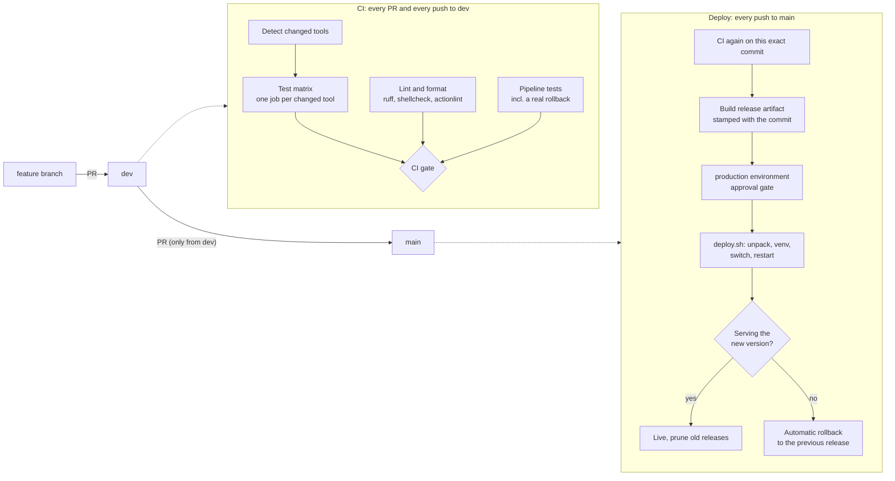

# internal-tools-cicd

A complete CI/CD pipeline for a monorepo of small internal tools, explained stage by stage and running for real in GitHub Actions.

At work I run a platform of twelve internal tools in one monorepo: one folder per tool, each with its own virtualenv, tests and deploy script, all on one Linux server behind one login. The rules in this repo come from there: branch from `dev`, test every tool you touched, fast-forward `dev` into `main`, deploy from `main` only, and never trust a deploy until the new version is actually serving. There, those rules are enforced by convention and scripts. Here they are fully automated.

The two tools in `tools/` are deliberately small demo apps, written for this repo. The pipeline around them is the point.

## The pipeline at a glance



## Repository layout

```
tools/
  status-board/        Flask app: is every internal service up?
  invoice-check/       Flask API: recompute invoice totals, report what doesn't add up
scripts/
  changed_tools.py     which tools does a change touch?
  build_release.sh     package one tool as an immutable artifact
  deploy.sh            go live, verify, roll back on failure
  ci/runner-service.sh stand-in for systemd on a GitHub-hosted runner
  tests/               tests for all of the above
.github/workflows/
  ci.yml               tests on every PR and every push to dev
  deploy.yml           release and deploy on every push to main
```

Every tool is self-contained: its own `requirements.txt` (pinned), its own `requirements-dev.txt`, its own tests and its own virtualenv. Nothing is shared between tools except the pipeline.

## Stage by stage

### 1. Branches: one direction only

| Branch | Meaning | How code gets there |
|---|---|---|
| feature branch | one topic, one tool where possible | your commits |
| `dev` | the shared working branch | pull request from a feature branch |
| `main` | what runs in production | pull request from `dev`, nothing else |

The `promotion` job in [`ci.yml`](.github/workflows/ci.yml) fails any pull request into `main` that doesn't come from `dev` in this repository, so `main` only receives what was already tested on `dev`. At work the promotion is a local `git merge --ff-only dev`, which GitHub's merge button can't do; that is one reason the Deploy workflow runs CI once more on the exact commit that lands on `main`.

### 2. Change detection: test what changed, and everything when in doubt

[`scripts/changed_tools.py`](scripts/changed_tools.py) turns a diff into a list of tools:

- a change under `tools/<name>/` selects that tool;
- a change to anything shared (`.github/`, `scripts/`, `ruff.toml`) selects every tool;
- a change to docs only selects nothing;
- when the change set can't be determined (a branch's first push, history that wasn't fetched), every tool is selected.

In the real platform the slowest suite takes three minutes and there are twelve of them. Running only what changed keeps feedback fast. The fallback is deliberate: testing too much costs minutes, testing too little ships a broken tool.

### 3. Test matrix: one job per tool, the way it runs on the server

The `test` job fans out into one job per selected tool (`fail-fast: false`, so one red tool doesn't hide another). Each job:

1. creates the tool's own virtualenv and installs its pinned dependencies, exactly like the server does;
2. runs the tests with a **90% coverage floor**;
3. keeps the JUnit report as an artifact, also when the tests fail.

### 4. Lint and format

`ruff check`, `ruff format --check`, `shellcheck` on every shell script and `actionlint` on the workflows themselves. Ruff runs with the security rules (`S`) on.

### 5. Pipeline tests: the deploy script is code, so it has tests

[`scripts/tests/`](scripts/tests) tests change detection against real temporary git repositories, the release build, and `deploy.sh` end to end against a real HTTP service. Among them:

- a broken release (one that crashes on start-up) is **rolled back automatically** and the old version serves again;
- a restart that *claims* success while the old code keeps serving is caught, and so is a restart command that fails outright;
- tool names such as `-oProxyCommand=...` are refused before anything is touched;
- a second deploy of the same tool waits for the lock;
- old releases are pruned, but the rollback target is always kept.

### 6. One gate

Branch protection needs a fixed list of required checks, but the matrix jobs change with every change set. So everything funnels into one job, **CI gate**, which passes only if every job succeeded or was rightly skipped. That one check is the only required status check on `dev` and `main`.

### 7. Release: build once, deploy that

On a push to `main`, [`deploy.yml`](.github/workflows/deploy.yml) first calls `ci.yml` again on exactly that commit, then [`build_release.sh`](scripts/build_release.sh) packages each changed tool into `tool-<commit>.tar.gz` with a `VERSION` file inside. Tests, virtualenvs and caches stay out. The artifact that is deployed is byte for byte the one that was built after CI passed; nothing is rebuilt on the server.

### 8. Deploy: prove it, or roll it back

The deploy job runs in the `production` environment, which is where an approval gate goes (*Settings → Environments → Required reviewers*). Deploys never run in parallel and are never cancelled halfway (`concurrency: deploy-production`). For each tool, [`deploy.sh`](scripts/deploy.sh):

1. takes a per-tool lock;
2. unpacks the artifact into `releases/<version>/` and builds a virtualenv for that release, so a rollback needs no reinstall. A failure here changes nothing: the live release is untouched;
3. switches the `current` symlink with a single `rename(2)`, so there is never a moment without a live release;
4. restarts the service;
5. polls the health endpoint until it reports **the new version**. A service that is "active" but still runs the old code is not a successful deploy. This is the lesson I learned on a real server: checking `is-active` is not enough;
6. on failure, switches back to the previous release, restarts, and verifies that one in the same way;
7. logs every attempt to `deploys.log` and prunes old releases.

| Exit code | Meaning |
|---|---|
| 0 | new release is live and healthy |
| 1 | new release failed; the previous release is live and healthy again |
| 2 | the first release of this tool failed; nothing to roll back to |
| 3 | new release and rollback both failed; the tool needs a person |
| 64 | usage error; nothing was touched |
| 75 | another deploy of this tool is running; nothing was touched |

After the deploy, a smoke test checks that the service reports the commit that was just built. Then a **rollback drill** deploys a deliberately broken build and requires the script to roll it back by itself. The drill is for this demo only; on a real production server, the pipeline tests from stage 5 cover the same ground.

## What runs where

| | In this repo | On a real server |
|---|---|---|
| Deploy runs on | a GitHub-hosted runner that plays the server | a self-hosted runner inside the network, since the server isn't reachable from GitHub's cloud |
| `DEPLOY_ROOT` | `$RUNNER_TEMP/opt` | `/opt/tools` |
| `RESTART_CMD` | [`scripts/ci/runner-service.sh`](scripts/ci/runner-service.sh) starts gunicorn | `sudo systemctl restart tool-<name>`, allowed for that one command only |
| Approval | none, so the demo runs end to end | required reviewers on the `production` environment |

## Run it yourself

```bash
# Tests of one tool, the way CI runs them
cd tools/invoice-check
python3 -m venv .venv && .venv/bin/pip install -r requirements-dev.txt
.venv/bin/pytest --cov=. --cov-fail-under=90

# Pipeline tests (from the repository root)
pip install -r scripts/requirements-dev.txt
python3 -m pytest scripts/tests

# A full local deploy with health check
art=$(scripts/build_release.sh status-board "$(git rev-parse HEAD)" dist)
DEPLOY_ROOT=/tmp/opt HEALTH_URL=http://127.0.0.1:8080/healthz \
RESTART_CMD='scripts/ci/runner-service.sh restart "$TOOL" 8080' \
  scripts/deploy.sh status-board "$art"
```

## Settings this pipeline expects on GitHub

- **Branch protection** on `dev` and `main`: require the **CI gate** status check, require a pull request, block force pushes.
- **Environment** `production`: add required reviewers to turn the deploy into an approved deploy.
